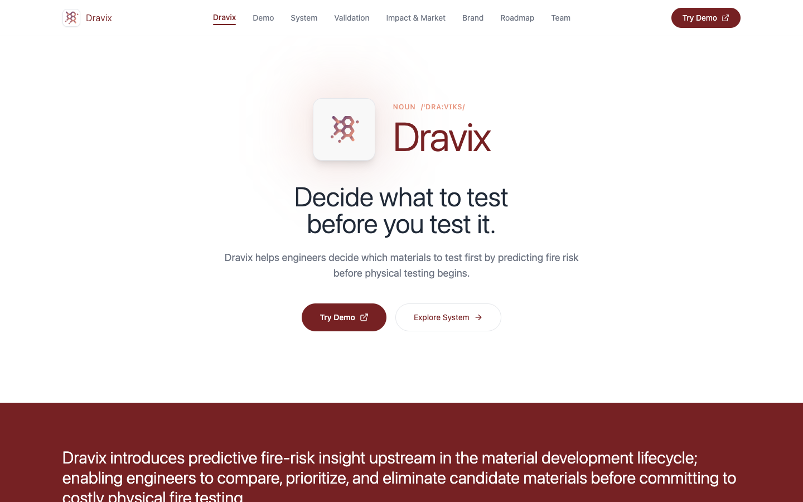

<p align="center">
  
</p>

# Dravix website

The product site for Dravix, a machine-learning tool that helps materials engineers decide which candidate materials to fire-test first.

**Live:** <https://dravix.materiamse.com> · **Engine and model:** [nikhilesh-s/dravix-engine](https://github.com/nikhilesh-s/dravix-engine) (demo at <https://dravix-engine.materiamse.com>)

## What it does

The site explains the project to engineers, judges and reviewers, one page per question they're likely to ask:

- **Dravix:** the problem and the one-line pitch, "Decide what to test before you test it."
- **Demo:** video walkthroughs of the screening engine.
- **System:** how material properties move through validation, feature engineering, the model and interpretability.
- **Validation:** how the model was checked, and where its limits are.
- **Impact & Market, Roadmap, Brand, Team, References.**

Every diagram is presented as a numbered figure, the way a paper would, and the copy stays careful about what the tool does and doesn't claim: it gives a relative screening signal, not a certification.

## Design

Quiet, clinical and editorial: lots of white, thin burgundy headlines, coral accents and soft rounded panels. The palette references fire without creating urgency, and hierarchy comes from size rather than weight.

| | |
|---|---|
| Type | System sans; headlines in light (300), labels in medium (500) |
| Color | `#762123` burgundy (headings, primary button) · `#E8967F` coral (eyebrows, dots) · `#784F74` berry (logo gradient) · `#F8F8F8` panels |
| Motion | Intentionally still: color transitions and smooth scroll on page change only |

## How it works

A single-page React app that switches between pages in state (no router) and scrolls to the top on each change. Figures are static images in `public/images/`, and demos are embedded videos. Hosted on Vercel.

**Stack:** React 18 · TypeScript · Vite · Tailwind CSS · lucide-react

## My role

I am the engineering lead on Dravix and designed and built this site with the team. Team: Nikhilesh Suravarjjala (engineering lead), Jaanya Gupta (business lead), Arnav Saini (data engineer).

## Run locally

```bash
npm install
npm run dev
```
